<br>

Fundei a **[Allvz](https://allvz.com.br)**, uma empresa de tecnologia no Rio de Janeiro, e respondo pela direção técnica. Na prática: desenho a arquitetura, escrevo o código, coloco em produção, treino quem vai usar e atendo quando algo quebra.

Este perfil não é uma lista de linguagens. É o que está rodando agora.


<br>

## A plataforma Allvz

O sistema de gestão de TI que a Allvz usa todo dia com os clientes. A direção, o gestor de cada empresa e cada colaborador entram no mesmo lugar, e cada um enxerga só o que é seu: o isolamento por empresa e por papel acontece no middleware, antes de qualquer tela.



<table>
<tr>
<td width="50%" valign="top">

**Chamados e SLA**<br>
A abertura segue o que o contrato cobre. Protocolo, comentário interno e aviso automático no grupo de WhatsApp da empresa.

</td>
<td width="50%" valign="top">

**Manutenção preventiva**<br>
Checklist e fotos de antes e depois, reduzidas no próprio celular para caber no limite da Vercel sem perder a etiqueta do número de série.

</td>
</tr>
<tr>
<td valign="top">

**Contratos**<br>
Aditivo, renovação automática e responsável financeiro. O visualizador é auditado: quanto tempo cada pessoa leu, quanto disso com a aba visível e até onde rolou.

</td>
<td valign="top">

**Cofre de senhas**<br>
AES-256-GCM, compartilhamento por item com ou sem prazo, exportação em planilha e senha oculta até entre gestores.

</td>
</tr>
<tr>
<td valign="top">

**Academy**<br>
Um LMS próprio: 21 trilhas, aula com verificação na hora, prova corrigida no servidor, certificado e o progresso da equipe na tela do gestor.

</td>
<td valign="top">

**Decks comerciais**<br>
Apresentações com analytics por slide: quantas vezes cada um foi visto e por quanto tempo.

</td>
</tr>
<tr>
<td valign="top">

**Avisos**<br>
Manutenção, atualização e comunicados com confirmação de leitura por pessoa, e o resumo sugerido pelo Gemini.

</td>
<td valign="top">

**Cobrança e indicadores**<br>
O cliente vê a conta e a nota e avisa pela tela quando paga. A direção e o gestor têm um painel de chamados cada um.

</td>
</tr>
</table>

<br>

## Decisões que eu defendo

**Backup guardado no mesmo lugar que os dados não é backup.**
O plano gratuito do Supabase não tem cópia automática, então um GitHub Actions tira o dump todo dia e confere o arquivo antes de guardar: dump vazio ou truncado derruba o job e gera e-mail. As fotos das preventivas saem num artefato semanal à parte, para a cota não estourar e levar o resto junto. A restauração é ensaiada por script, não suposta.

**Um banco vazado não entrega o cofre.**
Senha de serviço precisa voltar ao texto original, então é cifragem e não hash. AES-256-GCM, que também denuncia adulteração, com a chave só no ambiente. O formato gravado é versionado, `v1.iv.tag.conteudo`, para a cifragem poder mudar um dia sem perder o que já está guardado.

**Passkeys sem trancar ninguém do lado de fora.**
A chave privada nasce no Secure Enclave ou no TPM e não sai de lá; o servidor guarda só a pública, então vazar a tabela não abre conta nenhuma. A senha continua valendo como caminho de volta para quem perder o aparelho.

**O robô de WhatsApp não abre porta nenhuma.**
Ele roda numa máquina local com WPPConnect e conversa com a plataforma só pelo banco. O site grava o aviso numa fila, o robô pega cada item com uma atualização condicional (dois robôs nunca mandam a mesma mensagem) e devolve o estado. Computador desligado não perde aviso: só atrasa.

**Cada porta do Postgres para o seu trabalho.**
A aplicação usa a 6543 do Supavisor, em modo transação, que é a que aguenta serverless. Mudança de schema vai pela 5432, porque na 6543 um `prisma db push` fica pendurado para sempre sem dar erro.

**Regra de negócio se prova contra o banco.**
São 22 scripts `conferir-*` que checam o que a tela promete: quem enxerga qual senha, quando o contrato renova, quem vê qual trilha, quais rotas são públicas.

**Escrito para ser citado por IA.**
Além de Schema.org, sitemap e uma página por serviço, o site serve um `/llms.txt` com a empresa em texto puro. É uma rota, e não um arquivo solto, para não virar uma segunda fonte de verdade que alguém esquece de atualizar.

<br>

## Outros sistemas entregues

<table>
<tr>
<td width="50%" valign="top">

**Óticas Laenas** · óticas<br>
Gestão completa e PDV: ficha óptica de laboratório impressa em A5 com duas vias e QR code, cupom térmico de 80 mm, caixa com fechamento conferido, cupons, relatórios e multi-loja. Permissão checada em três camadas: middleware, server actions e interface. Next.js 16, Prisma 7, PostgreSQL 16, Docker e Coolify, em 152 commits.

</td>
<td width="50%" valign="top">

**Studio Thais Silva** · beleza<br>
Sistema para salão com agenda, comandas e controle de caixa.

**Paulo Lima Corretor** · imobiliário<br>
Plataforma de captação de leads qualificados, com CRM e painel de gestão para o corretor e a equipe.

**Plataforma CIPÓ** · instituto de pesquisa<br>
Consultoria de TI e suporte nível I e II na rotina da equipe.

</td>
</tr>
<tr>
<td colspan="2" valign="top">

**Diagnóstico Allvz** · ferramenta própria<br>
Um clique no computador do cliente e sai um relatório: bateria, discos, memória, desligamentos inesperados, antivírus, firewall e rede. PowerShell somente leitura, sem pedir senha de administrador, empacotado com Inno Setup e auto-atualização verificada. No fim, um botão manda o resumo pronto para o WhatsApp do suporte.

</td>
</tr>
</table>

<br>

## Stack



<br>

## Como eu trabalho

- **Preço fechado antes de começar**, dividido em etapas de entrega. Sem conta de horas crescendo no meio do caminho.
- **Quem desenha é quem atende.** A pessoa que decidiu como o sistema foi construído é a mesma que está na conversa quando algo precisa mudar.
- **Manual para quem vai usar**, e uma trilha na Academy para a equipe aprender.
- **Commit que conta o que mudou e por quê**, em português:

```console
$ git log --oneline
d3e1562 feat(backup): copia diaria fora do Supabase, com restauracao conferida
f44a0d4 feat(login): chave de acesso, com convite depois de entrar
e15b053 feat(cofre): compartilhamento sem prazo, e ocultar senhas de um gestor
3c0bef5 feat(contratos): dois contratos por cliente, aditivo e visualizador auditado
794fda8 feat(academy): telas de autoria e do aluno, com prova corrigida no servidor
0d14783 feat(avisos): manutencao, atualizacao e comunicados, com quem leu
a6bba34 feat(whatsapp): da para testar num grupo proprio antes de valer
807fc57 feat(linha do tempo): importa os commits lendo direto dos repositorios
```

<br>

## Vamos conversar

Se o seu processo ainda vive em planilha, WhatsApp e memória de alguém, é exatamente o tipo de coisa que eu gosto de transformar em sistema.

<p>
  <a href="https://www.linkedin.com/in/brunoferreiraalves/"></a>
  <a href="https://allvz.com.br"></a>
  <a href="mailto:contato@allvz.com.br"></a>
  <a href="https://wa.me/5511987935241"></a>
</p>
